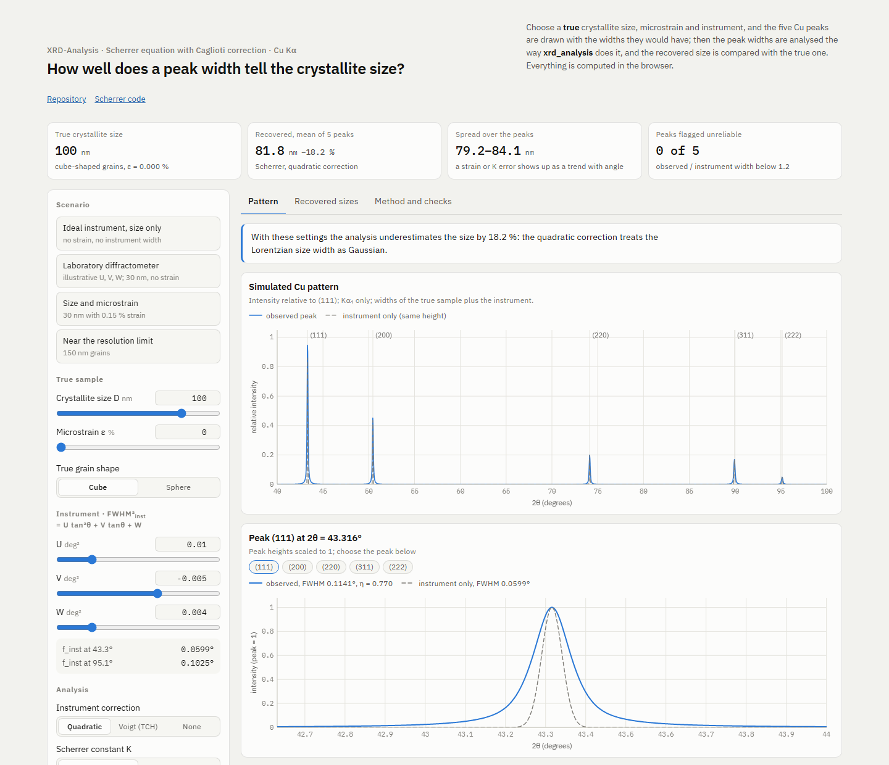

# XRD-Analysis

[](https://github.com/Shuruyue/XRD-Analysis/actions/workflows/ci.yml)
[](https://www.python.org/downloads/)
[](LICENSE)

**[Interactive page](https://shuruyue.github.io/XRD-Analysis/web/crystallite-size.html)**: set a true crystallite size, microstrain and instrument width, and see how well the Scherrer analysis of this package recovers the size. With illustrative laboratory instrument widths (0.06° to 0.10°), the common quadratic instrument correction underestimates a 100 nm crystallite size by 18 %, while the Voigt (TCH) correction used here recovers it exactly from noise-free peak widths; microstrain, which the Scherrer equation counts as size, still lowers the result (30 nm with 0.15 % strain comes out as 21 nm).

[](https://shuruyue.github.io/XRD-Analysis/web/crystallite-size.html)

## XRD Crystallite Size Analysis

Crystallite size from XRD patterns: Kα doublet peak fitting, Caglioti instrument correction and the Scherrer equation.

---

## Project Overview

xrd_analysis automates the steps of a Scherrer size analysis that are often done by hand, and where hand analysis is most error-prone:

- Subjective baseline selection errors
- Inaccurate instrumental broadening correction
- Incorrect peak profile function selection

Default constants and examples in this repository target Cu scans, but the workflow itself is not limited to electroplated Cu.

### Core Features

- **True Voigt + Kα doublet fitting**: each reflection is fitted as a Kα1 + Kα2 pair; Kα2 is tied to Kα1 by the Bragg shift and an intensity ratio of 0.5
- **Pseudo-Voigt fallback**: used only when the doublet fit does not converge
- **Double-correction guard**: when doublet fitting is on, Kα2 pre-stripping is turned off, so Kα2 is not removed twice
- **Caglioti instrument correction**: instrument width as a function of angle, calibrated from a LaB6 (NIST SRM 660c) scan
- **Validity flags**: sizes outside 2–200 nm, and peaks less than 1.2 times wider than the instrument, are flagged; a peak no wider than the instrument gives no size (NaN, `null` in the JSON output) rather than a number

---

## Quick Start

### Installation

```bash
pip install -e .
```

Or for development:

```bash
pip install -e ".[dev]"
```

### Run the example

```bash
# 1. Instrument calibration from a LaB6 standard scan
xrd-analysis calibrate examples/lab6_synthetic.txt -o outputs/calibration.yaml

# 2. Crystallite size of a Cu sample, corrected with that calibration
xrd-analysis analyze examples/cu_synthetic.txt --calibration outputs/calibration.yaml -o outputs/
```

The two patterns in [`examples/`](examples/) are simulated by `scripts/make_example_data.py`, not measured, so the right answer is known: a LaB6 standard with instrument broadening only, and Cu with 40 nm cube-shaped crystallites and no microstrain on the same instrument (Kα1 + Kα2, exact Voigt profiles, Poisson noise).

- The calibration reproduces the instrument width within 1 % over the LaB6 range (21–76°).
- The analysis finds all five Cu peaks within 0.002° of their positions and returns **37.3 nm** (34.7–38.5 nm per peak) for the true 40 nm. Most of the 7 % shortfall comes from the default preprocessing: Savitzky–Golay smoothing over 11 points (0.22°) widens the peaks by a few percent, and the global background fit takes area from the weak (222) peak. With `smoothing` and `background` disabled in the config the result is 39.3 nm.

`xrd-analysis analyze` writes:

- Per-sample result: `outputs/<sample>_analysis.json`
- Batch summaries: `outputs/analysis_summary.json` and `outputs/analysis_summary.csv`

### Your own data

Input files can be a Bruker TXT export with a `[Data]` section, a two-column `.xy` file or a `.csv` file with a header row. Pass a directory to analyze every pattern in it. `-c my_config.yaml` selects a configuration file (default: `config.yaml` in the working directory).

```bash
xrd-analysis calibrate path/to/lab6_scan.txt -o outputs/calibration.yaml
xrd-analysis analyze path/to/scans/ --calibration outputs/calibration.yaml -o outputs/
```

To store the calibration in a configuration file instead (the file is rewritten, so its comments are not kept):

```bash
python scripts/calibrate_instrument.py path/to/lab6_scan.txt -o outputs/calibration.yaml --update-config my_config.yaml
```

### Validation Scripts

```bash
pytest                                                                 # unit tests and the example run above
python scripts/verify_physics.py                                       # 2θ positions from Bragg's law
python scripts/verify_angle_accuracy.py examples/cu_synthetic.txt      # fitted peak positions vs reference
python scripts/verify_background_correction.py examples/cu_synthetic.txt
python scripts/verify_web_page.py                                      # page JavaScript vs package (needs Node.js)
```

---

## Project Structure

```text
XRD-Analysis/
├── config.yaml              # Global configuration
├── pyproject.toml           # Python project configuration
├── examples/                # Synthetic LaB6 and Cu patterns for the Quick Start
├── data/                    # Your own data (git-ignored apart from the folder layout)
│   ├── raw/                 # Raw XRD data
│   ├── standards/           # NIST standard data
│   └── processed/           # Preprocessed data
├── xrd_analysis/            # Core source code
│   ├── core/                # Physical constants and crystallography
│   ├── preprocessing/       # Data preprocessing modules
│   ├── fitting/             # Peak fitting core
│   ├── methods/             # Analysis methods (Scherrer, Caglioti, texture, defects)
│   ├── validation/          # Error analysis and validation
│   └── visualization/       # Plotting
├── scripts/                 # Verification and utility scripts, example generator
├── web/                     # Interactive page (GitHub Pages)
├── tests/                   # Unit tests
├── references/              # Literature PDFs (kept locally, not in the repository)
└── outputs/                 # Output directory (ignored by Git)
```

---

## Theoretical Background

### True Voigt Peak Profile

I(2θ) = A · V(2θ; σ, γ) + background

where V is the Voigt profile (Gaussian–Lorentzian convolution, evaluated with the Faddeeva function).

For Cu radiation, Kα2 is constrained from Kα1 by the Bragg shift and a fixed intensity ratio of 0.5.

### Caglioti Equation

FWHM_inst² = U · tan²θ + V · tanθ + W

### Instrument correction

The fitted width is split into Gaussian and Lorentzian parts (Thompson–Cox–Hastings); the instrument is removed from each part (quadratically from the Gaussian, linearly from the Lorentzian) and the sample width is recombined (Olivero–Longbothum). When the observed peak is no wider than the instrument, no sample width is left and the result is NaN.

### Scherrer Equation

D = K · λ / (β · cos θ)

---

## References

1. Bearden, J.A. (1967). X-Ray Wavelengths. Rev. Mod. Phys. 39, 78-124.
2. Caglioti, G., Paoletti, A. & Ricci, F.P. (1958). Nucl. Instrum. 3, 223-228.
3. Langford, J.I. & Wilson, A.J.C. (1978). Scherrer after Sixty Years. J. Appl. Cryst. 11, 102-113.
4. de Keijser, Th.H., Mittemeijer, E.J. & Rozendaal, H.C.F. (1983). J. Appl. Cryst. 16, 309-316.
5. Thompson, P., Cox, D.E. & Hastings, J.B. (1987). J. Appl. Cryst. 20, 79-83.
6. NIST Standard Reference Material 660c (LaB6)

---

## License

MIT License
